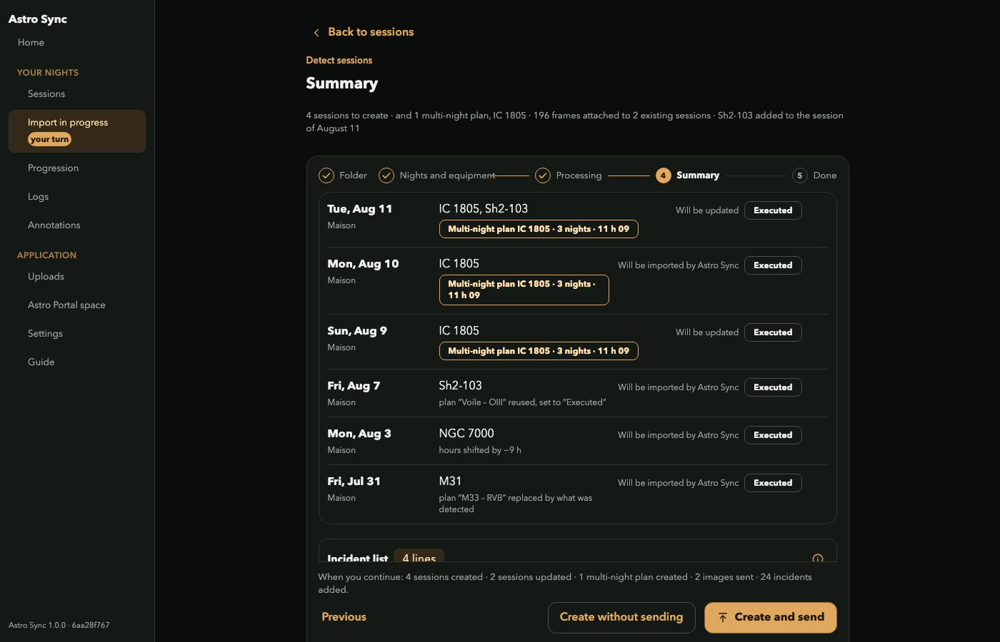

# Astro Sync

Astro Sync is the desktop companion of
[Astro Portal](https://github.com/sqound/astro-portal) and of the PlanAstro
application. When you ask it to, it reads the folders where your acquisition
software wrote a night (captures, logs, plate-solving results), builds the
package of each session, and sends it to your portal (your own private server
or the hosted service) with resumable uploads. It does not watch the folders
continuously: nothing is read or sent until you start an import. It also
analyses the night on your computer: the quality and the guiding of each frame,
and, optionally, a first stack of your FITS files.



_The result of reading a folder: the nights and targets found in the FITS
headers, shown before anything is created._

**It never copies, moves, renames or deletes a source file**: every access to
an associated folder is read-only. What it writes (its working folders, made of
links to your frames and of its own results) lives in its own folder,
`Documents/Astro Sync/` (created the first time the application starts).

Astro Sync belongs to the [PlanAstro](https://www.planastro.space) family: the
site presents the whole product, the hosted service and the applications.

## Install

Download the installer for your system from the
[latest release](https://github.com/sqound/astro-sync/releases/latest). The
file names carry no version:

| System                             | Files                                                                      |
| ---------------------------------- | -------------------------------------------------------------------------- |
| macOS (Apple silicon)              | `Astro-Sync_macos_arm64.dmg`, signed and notarized                         |
| macOS (Intel)                      | `Astro-Sync_macos_x64.dmg`, signed and notarized                           |
| Windows (x64)                      | `Astro-Sync_windows_x64-setup.exe`, the Windows installer, not yet signed  |
| Linux (x64, Ubuntu 22.04 or newer) | `Astro-Sync_linux_x64.deb` and `Astro-Sync_linux_x64.AppImage`, not signed |

The Windows installer of version 1.0.0 is not yet signed, so Windows may show a
SmartScreen warning: choose "More info", then "Run anyway".

On Linux, install the `.deb` with `sudo apt install ./Astro-Sync_linux_x64.deb`
(it pulls WebKitGTK 4.1), or make the `.AppImage` executable
(`chmod +x Astro-Sync_linux_x64.AppImage`) and run it. The `.AppImage` takes the
sound and graphics libraries from the system (`libasound2`, `libgbm1`,
`libegl1`, `libgl1`), which every desktop installation has; without FUSE
(`libfuse2`), run it with `--appimage-extract-and-run`. Both need glibc 2.35 or
newer. Neither is signed: check them against `SHA256SUMS.txt`.

The command-line tool (`astro-sync`) comes as
`astro-sync-cli_macos_arm64.tar.gz`, `astro-sync-cli_macos_x64.tar.gz`,
`astro-sync-cli_windows_x64.zip` and `astro-sync-cli_linux_x64.tar.gz`;
`SHA256SUMS.txt` lists the checksums of every file of a release.

Every file is built by the release workflow of this repository
(`.github/workflows/release.yml`), on GitHub's runners, from the tagged commit.

## Connecting to a portal

In the application, choose "Private server" and type the
address of your portal (for example `http://192.168.1.20:8787` on your network,
or its https address), then sign in the way your portal announces: a code
received by e-mail, or the pairing code its account page shows. The command line
takes the same address with `--portal`.

## What it reads of the service's rights

Astro Sync reads `GET /v1/entitlements` for one thing: whether the service
has put the space in read-only because a payment failed, and until when (a
subscription `on_hold` in `purchases`, with `endedAt` and `readOnlyUntil`), so
that it can say why what it sends is held. A private server answers that route
with an empty `purchases`, and Astro Sync then says nothing. The answers its
tests play are its own, reduced to those fields:
[`crates/astro-sync-core/tests/fixtures/standing-answers.json`](crates/astro-sync-core/tests/fixtures/standing-answers.json);
the answer of a private server is the one recorded in `contracts/`.

## Build from source

Requirements: Rust (the toolchain pinned in `rust-toolchain.toml`), Node.js 24,
and, for the desktop application, the system libraries Tauri 2 needs on your
platform (see [Tauri's prerequisites](https://v2.tauri.app/start/prerequisites/)).

```bash
cargo build --workspace          # the library and the command line
cargo test --workspace
cd app && npm ci && npm run build && npm test   # the interface: type-check, bundle, tests
npm run tauri build               # the desktop application
```

## Layout

```text
crates/astro-sync-core/  the library: association, scanning, session packages, uploads, sign-in
crates/astro-sync-cli/   the command line (`astro-sync`), over the same library
app/                     the desktop application: Tauri 2 and a React/TypeScript interface
app/src-tauri/           its Rust shell (a Cargo project of its own)
stacking/                the optional stacking of FITS files (Python)
contracts/               the portal's API contracts the tests replay (fixtures, schemas, locale registry)
```

## Stacking pipelines

The optional stacking of a target’s FITS files lives in `stacking/`: a Python
script drives Siril and writes only to `<target>/stacked/`, never into your
source folders. The render pipelines (the shipped ones, and your own, kept in
the application’s data folder) are declared in manifests: see
[`stacking/README.md`](stacking/README.md) and the format in
[`stacking/pipelines/SCHEMA.md`](stacking/pipelines/SCHEMA.md).

## Python and Siril (optional stacking)

Everything above works without them. The stacking of FITS files is the only
part that needs more: a **Python 3.12 to 3.14** environment and
[Siril](https://siril.org) (1.4 or later), which does the calibration and the
registration. Astro Sync does not bundle either. The application creates the
Python environment itself (Settings, "Dependencies": a virtual environment of
pinned, hash-checked packages, about 300 MB, on your computer only), detects
Siril and offers its download page (on Linux, the Siril of the distribution can
be older than 1.4, as Ubuntu's 1.2: take it from siril.org); StarNet2 is an
optional extra for some renders. Nothing is installed without your asking, and no FITS file leaves your
computer. The details, versions and licences are in
[`stacking/DEPENDENCIES.md`](stacking/DEPENDENCIES.md).

## Reporting a problem

- A bug or a question: open an issue on
  [github.com/sqound/astro-sync/issues](https://github.com/sqound/astro-sync/issues)
  with your system, the version of Astro Sync and what you did and saw. Do not
  attach your images or your portal's address.
- Anything else, or if you prefer e-mail: [dev@sqound.jp](mailto:dev@sqound.jp).
- A security vulnerability: do not open a public issue; follow
  [SECURITY.md](SECURITY.md).

## License

Astro Sync is free software under the MIT license ([LICENSE](LICENSE)).

## Contributing

See [CONTRIBUTING.md](CONTRIBUTING.md). Astro Sync is published by Sqound.
